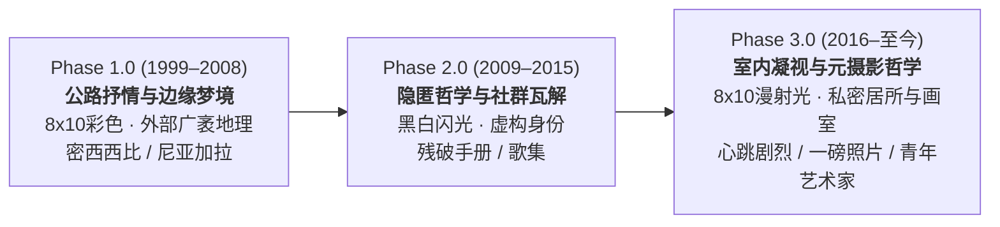

# 埃里克·索斯 (Alec Soth) 摄影作品全景导览与美学系谱

> **文献定位**：美国当代抒情纪实摄影先锋、玛格南图片社（Magnum Photos）成员埃里克·索斯（Alec Soth）代表作深度解析与创作演进谱系。  
> **官方摄影档案**：[Alec Soth Projects 官网](https://alecsoth.com/photography/projects/)  
> **配套交互导览页面**：[index.html](file:///Users/zhuangnd/Documents/my_projects/viz/alec_soth/index.html)（支持鼠标悬停预览与高分辨率弹窗缩放）

---

## 1. 摄影师概况与历史坐标

埃里克·索斯（Alec Soth，1969年出生于美国明尼苏达州明尼阿波利斯），是21世纪最具国际影响力的美国纪实与艺术摄影家之一。2004年以《眠于密西西比河畔》（*Sleeping by the Mississippi*）在惠特尼双年展一举成名，同年获提名加入玛格南图片社，2008年成为正式全资格会员。

### 历史传承脉络
索斯的摄影语言直接继承并重构了自20世纪30年代以来的美国大画幅与公路摄影道统：
- **沃克·埃文斯（Walker Evans）**：严谨的正面构图、建筑立面与平民居所的直白记录。
- **罗伯特·弗兰克（Robert Frank）**：对美国神话阴暗面、孤独漫游与异乡疏离感的敏锐捕捉。
- **威廉·埃格尔斯顿（William Eggleston）与斯蒂芬·肖尔（Stephen Shore）**：将日常平凡之物升华为色彩诗学，赋予彩色负片以严肃艺术地位。

在此基础上，索斯注入了浓郁的**中西部文学气质**（受马克·吐温、沃尔特·惠特曼、华莱士·史蒂文斯与约翰·贝里曼深刻影响），将纪实摄影由“外向的社会批判”引向“内向的抒情冥想与心理投射”。

---

## 2. 核心创作哲学与美学密码

### 2.1 8×10 大画幅与慢速肖像伦理
索斯长期坚持使用极为笨重、需要三脚架支撑与黑布遮罩的 **Deardorff 8×10 木质大画幅座机**。
- **反抓拍的共谋机制**：摄影师无法偷拍或速决，每一次释放快门前，都需要长达数分钟的调焦、测光与装片。被摄者必须在充分知情与同意下与摄影师保持静止对视，这种“笨拙的仪式感”消解了攻击性，催生出肖像之间罕见的坦诚与脆弱。
- **物质细节的沉重微粒**：8×10 底片庞大的感光面积，能以惊人的微观精度记录皮肤纹理、室内尘埃、剥落的壁纸与织物褶皱，赋予微小物体以神圣的纪念碑性。

### 2.2 摄影书（Photobook）作为终极文学载体
索斯认为“单幅摄影往往是贫瘠的，只有次序（Sequencing）能创造诗意”。
- 他把摄影书视为短篇小说集或抒情诗集。
- 图像与图像之间的并置（Montage）、翻页时的节奏起伏、空白页的停留，构成了叙事的复调结构。例如在《眠于密西西比河畔》中，一张空床的特写紧接着一张囚犯的肖像，使得“禁锢与睡眠”产生共振。

### 2.3 美式孤独与“渴望逃匿”的双向拉扯
索斯作品永恒的主题是两种冲动的拉锯：
1. **隐匿冲动（The Desire to Disappear）**：想要逃离社会规则、家庭契约、资本机器与文明监控，遁入荒野、洞穴或公路的极度渴望。
2. **联结渴望（The Longing for Connection）**：面对虚无与孤立时，极度渴望被他人理解、抚慰与拥抱的剧烈心跳。

---

## 3. 八大核心作品与官方档案映射

所有作品图源与系列均已映射至 [alecsoth.com 官方摄影档案](https://alecsoth.com/photography/projects/)：

| 序号 | 作品名称（中 / 英） | 官方项目链接 | 创作年份 | 核心介质与形制 | 代表性标志照片 |
| :--- | :--- | :--- | :--- | :--- | :--- |
| 01 | **《眠于密西西比河畔》** *Sleeping by the Mississippi* | [官网项目页](https://alecsoth.com/photography/projects/sleeping-by-the-mississippi) | 2004 (1999–2002) | 8×10 彩色负片 Steidl 出版 | · [Charles, Vasa, MN, 2002](https://alecsoth.com/photography/media/pages/projects/sleeping-by-the-mississippi/0c857a657b-1551319080/2002_03zl0033_f.jpg) · [Sugar's, Davenport, IA](https://alecsoth.com/photography/media/pages/projects/sleeping-by-the-mississippi/d8c2daa064-1551319080/2002_03zl0121b.jpg) · [Mother and Daughter](https://alecsoth.com/photography/media/pages/projects/sleeping-by-the-mississippi/2047740224-1551319080/2002_03zl0106-f.jpg) |
| 02 | **《尼亚加拉》** *Niagara* | [官网项目页](https://alecsoth.com/photography/projects/niagara) | 2006 (2004–2005) | 8×10 彩色负片 Steidl 出版 | · [Rebecca, 2005](https://alecsoth.com/photography/media/pages/projects/niagara/dca38e10a7-1551319080/2005_5zl0069_f.jpg) · [Melissa, 2005](https://alecsoth.com/photography/media/pages/projects/niagara/42d6303920-1551319080/2005_05zl0090_f.jpg) · [Falls 26, 2005](https://alecsoth.com/photography/media/pages/projects/niagara/c68872c65b-1551319080/2005_09zl0126_f.jpg) |
| 03 | **《W的最后几天》** *The Last Days of W* | [官网项目页](https://alecsoth.com/photography/projects/last-days-of-w) | 2008 (2008) | 轮转新闻纸印刷 大开本 Zine | · [Home, Treasure Island Casino](https://alecsoth.com/photography/media/pages/projects/last-days-of-w/ecebefe6df-1551319080/2002_03zl0014_f.jpg) · [First Baptist Church](https://alecsoth.com/photography/media/pages/projects/last-days-of-w/d44bd0d7ae-1551319080/2007_02zl0890_small_f.jpg) |
| 04 | **《残破手册》** *Broken Manual* | [官网项目页](https://alecsoth.com/photography/projects/broken-manual) | 2010 (2006–2010) | 复合媒介装置 手工掏空旧书暗格 | · [Broken Book 暗盒装置](https://alecsoth.com/photography/media/pages/projects/broken-manual/9ef72548af-1551319080/broken-book.jpg) · [Roman. The nocturnal hermit](https://alecsoth.com/photography/media/pages/projects/broken-manual/3e50492fcf-1551319080/oldman003_ver1.jpg) · [Utah? 洞穴掩体](https://alecsoth.com/photography/media/pages/projects/broken-manual/6aa221ab54-1551319080/2008_08zl0197-ver7.jpg) |
| 05 | **《歌集》** *Songbook* | [官网项目页](https://alecsoth.com/photography/projects/songbook) | 2015 (2012–2014) | 中画幅黑白胶片 机顶直打闪光 / MACK | · [Bil. Sandusky, Ohio (跳水者)](https://alecsoth.com/photography/media/pages/projects/songbook/065ecb501d-1551319080/01-2012_05md1000_0525-bf-copy.jpg) · [Prom #2 (舞会拥抱)](https://alecsoth.com/photography/media/pages/projects/songbook/1ab49731cf-1551319080/56-2012_05md1001-0367-bf-copy.jpg) |
| 06 | **《我知晓你的心跳有多剧烈》** *I Know How Furiously...* | [官网项目页](https://alecsoth.com/photography/projects/i-know-how-furiously-your-heart-is-beating) | 2019 (2017–2018) | 8×10 彩色大画幅 室内柔和漫射光 / MACK | · [Anna. Kentfield, California](https://alecsoth.com/photography/media/pages/projects/i-know-how-furiously-your-heart-is-beating/c41995d458-1551369195/2017_11zl0006.jpg) · [Ute’s Books. Odessa](https://alecsoth.com/photography/media/pages/projects/i-know-how-furiously-your-heart-is-beating/654cb47755-1551369195/2018_05zl0089.jpg) |
| 07 | **《一磅照片》** *A Pound of Pictures* | [官网项目页](https://alecsoth.com/photography/projects/a-pound-of-pictures) | 2022 (2018–2021) | 8×10 彩色负片 MACK 出版 | · [White Bear Lake, Minnesota](https://alecsoth.com/photography/media/pages/projects/a-pound-of-pictures/bf34f1fc3e-1641923116/2019_08zl0016.jpg) · [Camera Club. Pennsylvania](https://alecsoth.com/photography/media/pages/projects/a-pound-of-pictures/502791fb01-1641923117/2019_11zl0030.jpg) |
| 08 | **《给年轻艺术家的建议》** *Advice for Young Artists* | [官网项目页](https://alecsoth.com/photography/projects/advice-for-young-artists) | 2024 (2022–2024) | 大画幅彩色摄影 MACK 出版 | · [Anatomy Figure 解剖模型](https://alecsoth.com/photography/media/pages/projects/advice-for-young-artists/a4a5a628fd-1724955277/2023_03md0000-341-335.jpg) · [Amalia 阿玛莉亚](https://alecsoth.com/photography/media/pages/projects/advice-for-young-artists/d252552e17-1724955277/2023_10md0001-638-637.jpg) |

---

## 4. 三大美学范式转向对比

---

## 5. 出版实验机构：Little Brown Mushroom (LBM)

2008年，索斯在其家乡圣保罗创立独立出版厂牌 **Little Brown Mushroom（小褐菇出版社）**。

### 实践维度
1. **反击画册金融化**：对抗艺术市场上动辄数百美元的限量精装画册，以廉价新闻纸印刷《The LBM Dispatch》，让普通大众在咖啡馆与报摊随手可得。
2. **图文互文实验**：与纪实作家布拉德·泽拉（Brad Zellar）共同上路，文本不再是图片的说明注脚，而是平行的文学乐章。
3. **教育与工作坊**：创办“社交障碍讲故事者夏令营”（Camp for Socially Awkward Storytellers），鼓励内向、羞怯的青年创作者探索独特的叙事路径。

---

## 6. 交互功能与导览入口

- **交互体验主页**：[viz/alec_soth/index.html](file:///Users/zhuangnd/Documents/my_projects/viz/alec_soth/index.html)
  - **悬停预览**：鼠标悬停任意标志性作品条目，触发无延迟缩略图卡片浮层。
  - **缩放弹窗**：点击标志性作品打开全屏灯箱，支持**鼠标滚轮连续缩放（0.5x–4.5x）、拖拽自由平移、双击放大切换与键盘快捷键（方向键切图、+/-缩放、Esc退出）**。
- **Viz 根目录作品索引**：[viz/index.html](file:///Users/zhuangnd/Documents/my_projects/viz/index.html)
